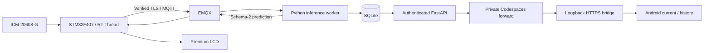

# RT-Spark Activity Recognition

BCA182 Lab 3 implements a three-class activity monitor using an RT-Spark STM32F407 board, RT-Thread, secure MQTT, a Python inference backend and a native Android dashboard.

The genuine hardware demonstration completed on **November 13, 2026**. The preserved deliverable package was verified on **November 14, 2026**. This repository contains a curated source copy and the frozen models from that package.

## System architecture

- The ICM-20608-G acquisition stream runs at 50 Hz, with filtered telemetry exported at 5 Hz through RW007 Wi-Fi.
- The backend selects 41 features from the existing 56-feature extractor over 20 samples, approximately four seconds.
- The frozen classifier predicts **STATIONARY**, **WALKING** and **RUNNING**. OFFLINE, WAITING and UNKNOWN represent separate system states.
- Device, placement, model, boot and freshness checks control admission and prediction display. SQLite retains admitted observations, predictions and the downlink outbox.
- The Android application displays authenticated current state and history. Its preserved implementation enables `FLAG_SECURE` and uses protected credential storage.

## Recorded results

| Check | Preserved result |
| --- | --- |
| November 13 observation | 21.20.18–21.24.10, Asia/Shanghai |
| Hardware telemetry publications | 198 |
| Accepted prediction downlinks | 175 |
| Observed classes | STATIONARY, WALKING, RUNNING |
| TLS connections / failures / verification flags | 1 / 0 / 0 |
| Raw / filtered sample drops | 0 / 0 |
| New session fault or unexpected reboot | None recorded |
| Stale downlinks rejected | 20 |
| Cleanup | Confirmed, with terminal STOP and cleared credential flags |

The separate, sealed C/D evaluation contains 498 windows across six trials. Balanced accuracy is **97.99%**, with recall of 100% walking, 93.98% running and 100% stationary. The ten errors are running-to-walking classifications. These metrics apply to that fixed-placement evaluation. The November 13 demonstration has no synchronized ground-truth scoring sheet for calculating a new accuracy figure.

The validated scope covers one wearer and the fixed front-sling placement `sling-lcddown-v1`, with the LCD down and USB toward the wearer. Overlapping evaluation windows are correlated. The saved Android demonstration used an API30 emulator. Physical LCD verification was reported by the owner, with UART records independently establishing its software labels. The historical HardFault investigation remains unresolved, while the successful session records no new fault or unexpected reboot.

## Repository layout

| Directory | Contents |
| --- | --- |
| `firmware/rtspark_integrated_v1/` | Preserved application, board configuration, STM32 HAL and active packages |
| `firmware/rt-thread/` | Matching RT-Thread 4.1.1 kernel, components and SCons tools |
| `backend/` | FastAPI, MQTT ingestion, SQLite, model adapters and selected offline tests |
| `ml/` | Original feature extraction, pinned dependencies and phone-baseline compatibility artifact |
| `models/three-class-v2/` | Frozen three-class model and its original manifest |
| `android/` | Premium application source, tests and loopback HTTPS bridge |
| `docs/` | Setup, demonstration summary, artifact identities and publication boundaries |

Start with the setup guide. The source preserves the separate release-authorization gate. Production activation requires the owner's existing private authorization, credentials and deployment configuration. [Setup instructions](docs/SETUP.md)

The README summarizes the preserved evidence. Original UART records, Android XML/history, deployment receipts, authorization files, database contents, firmware images, APKs and historical backups remain in the local final package. [Demonstration details](docs/DEMONSTRATION.md)

## Reproducibility and security

Application and model source files retain their original bytes. Runtime directories were moved together to the repository root, preserving their relative imports and model paths. Unused vendor test data, inactive dependencies and build outputs were omitted. The missing `ml/requirements.txt` include was restored from the original project and checked against the frozen dependency versions.

The model manifest retains its original research flags. The later hardware release was approved through a separate authorization document, which remains private. The runtime continues to require that document for production activation. Model loading also checks the frozen hashes and dependency versions. [Artifact identities](docs/ARTIFACTS.md)

Secrets belong in private environment settings or protected local files. Keep Codespaces port **8000 Private**, enforce exact-topic broker permissions and retain TLS CA/hostname verification. The repository excludes `.env` files, signing keys, deployment evidence, databases, logs, dumps and generated application binaries. [Publication scope](docs/PUBLICATION_SCOPE.md)

## Attribution

The project integrates RT-Thread, STM32 HAL/CMSIS, Mbed TLS, Eclipse Paho and RT-Thread sensor/Wi-Fi packages. Original notices and available bundled license files are retained. The phone-baseline artifact derives from Viktor Malyi's Run or Walk v2 dataset under CC BY-NC-SA 4.0. Its role and limitations are documented separately from the board-trained three-class model. [Third-party notices](THIRD_PARTY_NOTICES.md)
